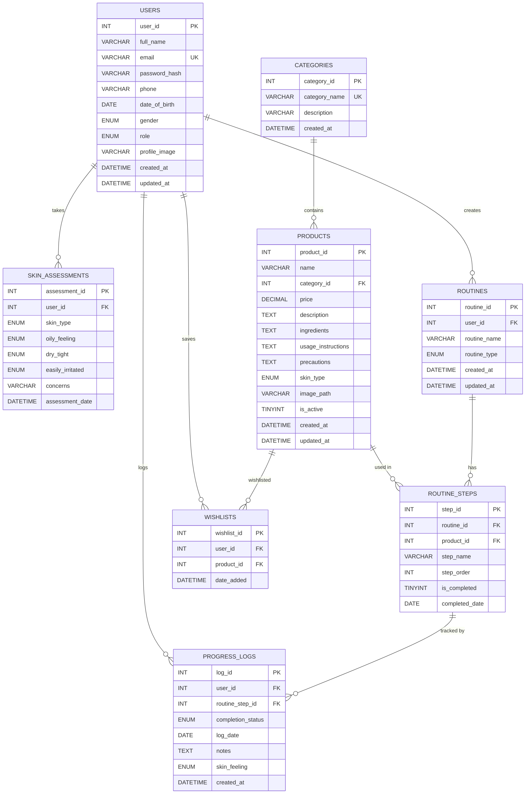

# GlowCare – Entity-Relationship Diagram

## ER Diagram (Mermaid erDiagram Syntax)

The following diagram shows all **8 tables** in the GlowCare database, their attributes, data types, and relationships with cardinality.

---

## Table Relationships Summary

| Relationship | Cardinality | Foreign Key | ON DELETE | ON UPDATE |
|---|---|---|---|---|
| USERS → SKIN_ASSESSMENTS | One-to-Many | `skin_assessments.user_id` → `users.user_id` | CASCADE | CASCADE |
| USERS → ROUTINES | One-to-Many | `routines.user_id` → `users.user_id` | CASCADE | CASCADE |
| USERS → PROGRESS_LOGS | One-to-Many | `progress_logs.user_id` → `users.user_id` | CASCADE | CASCADE |
| USERS → WISHLISTS | One-to-Many | `wishlists.user_id` → `users.user_id` | CASCADE | CASCADE |
| CATEGORIES → PRODUCTS | One-to-Many | `products.category_id` → `categories.category_id` | RESTRICT | CASCADE |
| PRODUCTS → ROUTINE_STEPS | One-to-Many | `routine_steps.product_id` → `products.product_id` | SET NULL | CASCADE |
| PRODUCTS → WISHLISTS | One-to-Many | `wishlists.product_id` → `products.product_id` | CASCADE | CASCADE |
| ROUTINES → ROUTINE_STEPS | One-to-Many | `routine_steps.routine_id` → `routines.routine_id` | CASCADE | CASCADE |
| ROUTINE_STEPS → PROGRESS_LOGS | One-to-Many | `progress_logs.routine_step_id` → `routine_steps.step_id` | SET NULL | CASCADE |

---

## Key Constraints

| Constraint Type | Table | Column(s) | Details |
|---|---|---|---|
| PRIMARY KEY | All tables | `*_id` columns | Auto-increment integer |
| UNIQUE | `users` | `email` | Prevents duplicate registrations |
| UNIQUE | `categories` | `category_name` | Prevents duplicate category names |
| UNIQUE (Composite) | `wishlists` | `(user_id, product_id)` | Prevents duplicate wishlist entries |
| CHECK | `products` | `price` | `price >= 0` |
| ENUM | `users` | `gender` | Male, Female, Other, Prefer not to say |
| ENUM | `users` | `role` | user, admin |
| ENUM | `skin_assessments` | `skin_type` | oily, dry, combination, normal, sensitive |
| ENUM | `products` | `skin_type` | oily, dry, combination, normal, sensitive, all |
| ENUM | `routines` | `routine_type` | morning, evening |
| ENUM | `progress_logs` | `completion_status` | completed, skipped, partial |
| ENUM | `progress_logs` | `skin_feeling` | great, good, okay, bad, terrible |

---

## Indexes

| Table | Index Name | Column(s) | Purpose |
|---|---|---|---|
| `users` | `idx_users_email` | `email` | Fast login lookups |
| `users` | `idx_users_role` | `role` | Filter users by role |
| `skin_assessments` | `idx_assessment_user` | `user_id` | Retrieve assessments by user |
| `products` | `idx_product_category` | `category_id` | Filter products by category |
| `products` | `idx_product_skin_type` | `skin_type` | Filter products by skin type |
| `products` | `idx_product_price` | `price` | Sort/filter by price |
| `routines` | `idx_routine_user` | `user_id` | Retrieve routines by user |
| `routines` | `idx_routine_type` | `routine_type` | Filter by morning/evening |
| `routine_steps` | `idx_step_routine` | `routine_id` | Retrieve steps by routine |
| `routine_steps` | `idx_step_order` | `step_order` | Order steps correctly |
| `progress_logs` | `idx_progress_user` | `user_id` | Retrieve logs by user |
| `progress_logs` | `idx_progress_date` | `log_date` | Filter/sort by date |
| `wishlists` | `idx_wishlist_user` | `user_id` | Retrieve wishlist by user |

---

*GlowCare – Personal Skincare Assistant © 2026*
