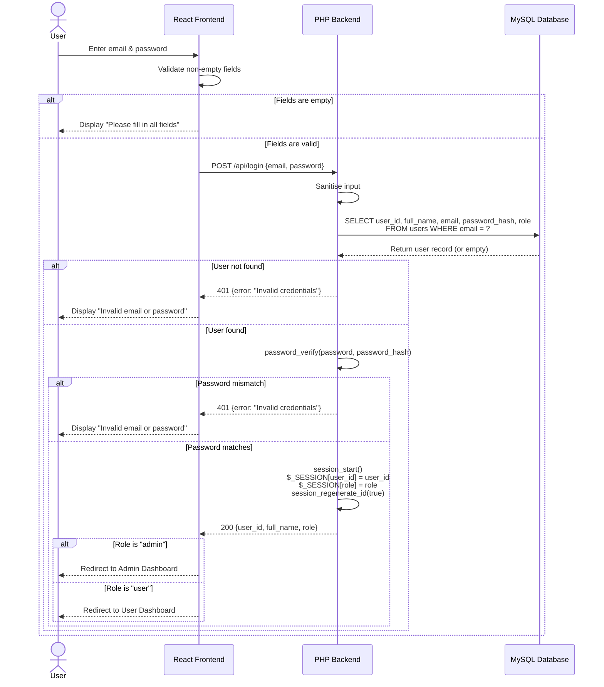
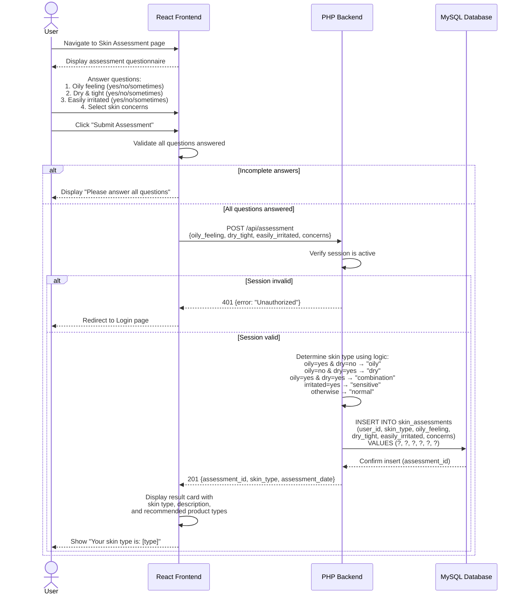
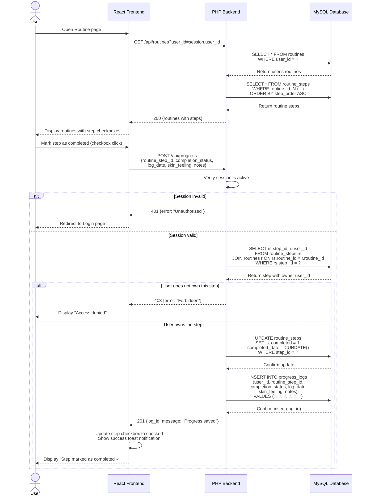

# GlowCare – Sequence Diagrams

This document contains UML sequence diagrams for three key system interactions, rendered using Mermaid syntax.

---

## 1. User Login Flow

---

## 2. Skin Assessment Flow

---

## 3. Save Routine Progress Flow

---

## Diagram Legend

| Symbol | Meaning |
|--------|---------|
| `—>>` | Synchronous message (request) |
| `-->>` | Response / return message |
| `alt / else` | Conditional alternative flows |
| `actor` | External user interacting with the system |
| `participant` | System component (frontend, backend, database) |

---

*GlowCare – Personal Skincare Assistant © 2026*
