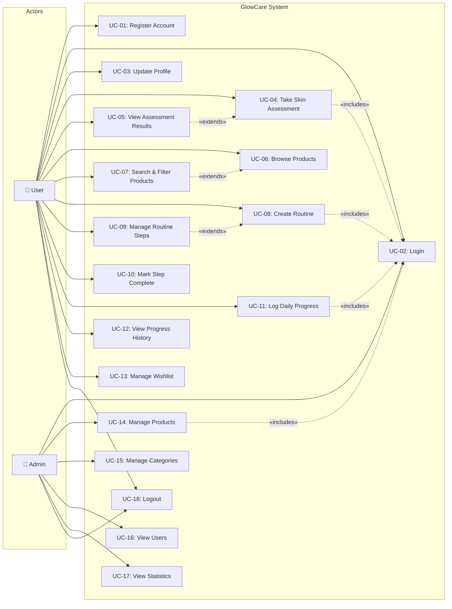

# GlowCare – Use-Case Diagram

## Use-Case Diagram (Mermaid Flowchart Representation)

Since Mermaid does not support native UML use-case diagram syntax, the following flowchart represents the actors, use cases, and their relationships.

---

## Use-Case Descriptions

### UC-01: Register Account

| Field | Description |
|-------|-------------|
| **Use Case ID** | UC-01 |
| **Use Case Name** | Register Account |
| **Actor(s)** | User |
| **Description** | A new user creates an account by providing personal details. |
| **Pre-conditions** | User has not previously registered with the same email. |
| **Main Flow** | 1. User navigates to the registration page.   2. User fills in full name, email, password, and optional fields (phone, DOB, gender).   3. System validates input (unique email, strong password).   4. System stores user record with hashed password.   5. System redirects to the login page with success message. |
| **Post-conditions** | A new user record exists in the `users` table. |
| **Alternate Flows** | A1: Duplicate email → System displays error "Email already registered."   A2: Weak password → System displays password requirements. |

---

### UC-02: Login

| Field | Description |
|-------|-------------|
| **Use Case ID** | UC-02 |
| **Use Case Name** | Login |
| **Actor(s)** | User, Admin |
| **Description** | A registered user authenticates with email and password. |
| **Pre-conditions** | User has a registered account. |
| **Main Flow** | 1. User enters email and password.   2. System verifies credentials against `users` table.   3. System creates a session with user ID and role.   4. System redirects: `user` → Dashboard, `admin` → Admin Panel. |
| **Post-conditions** | An active session is established. |
| **Alternate Flows** | A1: Wrong password → "Invalid credentials" error.   A2: Email not found → "No account found" error. |

---

### UC-03: Update Profile

| Field | Description |
|-------|-------------|
| **Use Case ID** | UC-03 |
| **Use Case Name** | Update Profile |
| **Actor(s)** | User |
| **Description** | A logged-in user updates their personal information. |
| **Pre-conditions** | User is authenticated. |
| **Main Flow** | 1. User navigates to Profile page.   2. User edits full name, phone, DOB, gender, or profile image.   3. System validates and saves updated fields.   4. System displays success confirmation. |
| **Post-conditions** | User record is updated in the database. |
| **Alternate Flows** | A1: Invalid image format → "Only JPG, PNG, GIF allowed" error. |

---

### UC-04: Take Skin Assessment

| Field | Description |
|-------|-------------|
| **Use Case ID** | UC-04 |
| **Use Case Name** | Take Skin Assessment |
| **Actor(s)** | User |
| **Description** | User completes a questionnaire to determine their skin type. |
| **Pre-conditions** | User is authenticated. |
| **Main Flow** | 1. User navigates to Skin Assessment page.   2. System presents questions (oily feeling, dryness, irritation, concerns).   3. User answers all questions and submits.   4. System determines skin type based on answers.   5. System saves assessment to `skin_assessments` table.   6. System displays result with skin type description. |
| **Post-conditions** | A new assessment record is saved. User's skin type is determined. |
| **Alternate Flows** | A1: Incomplete submission → "Please answer all questions" error. |

---

### UC-05: View Assessment Results

| Field | Description |
|-------|-------------|
| **Use Case ID** | UC-05 |
| **Use Case Name** | View Assessment Results |
| **Actor(s)** | User |
| **Description** | User views their skin assessment history and latest result. |
| **Pre-conditions** | User has completed at least one assessment. |
| **Main Flow** | 1. User navigates to Assessment Results.   2. System retrieves all assessments for the user.   3. System displays the latest skin type prominently and historical results in a list. |
| **Post-conditions** | None (read-only operation). |

---

### UC-06: Browse Products

| Field | Description |
|-------|-------------|
| **Use Case ID** | UC-06 |
| **Use Case Name** | Browse Products |
| **Actor(s)** | User |
| **Description** | User views the product catalogue with active products. |
| **Pre-conditions** | None (public or authenticated access). |
| **Main Flow** | 1. User navigates to Products page.   2. System retrieves active products with category names.   3. Products are displayed in a card grid with image, name, price, and skin type badge.   4. Pagination is applied if results exceed page size. |
| **Post-conditions** | None (read-only operation). |

---

### UC-07: Search & Filter Products

| Field | Description |
|-------|-------------|
| **Use Case ID** | UC-07 |
| **Use Case Name** | Search & Filter Products |
| **Actor(s)** | User |
| **Description** | User narrows down the product catalogue using search and filter controls. |
| **Pre-conditions** | User is on the Products page. |
| **Main Flow** | 1. User enters a keyword in the search bar and/or selects category, skin type, sort order filters.   2. System queries products matching criteria.   3. Filtered results are displayed. |
| **Post-conditions** | Product listing reflects applied filters. |

---

### UC-08: Create Routine

| Field | Description |
|-------|-------------|
| **Use Case ID** | UC-08 |
| **Use Case Name** | Create Routine |
| **Actor(s)** | User |
| **Description** | User creates a new morning or evening skincare routine. |
| **Pre-conditions** | User is authenticated. |
| **Main Flow** | 1. User clicks "New Routine".   2. User enters routine name and selects type (morning/evening).   3. System creates the routine record.   4. User is redirected to the routine detail page to add steps. |
| **Post-conditions** | A new routine record exists in the `routines` table. |

---

### UC-09: Manage Routine Steps

| Field | Description |
|-------|-------------|
| **Use Case ID** | UC-09 |
| **Use Case Name** | Manage Routine Steps |
| **Actor(s)** | User |
| **Description** | User adds, edits, reorders, or deletes steps within a routine. |
| **Pre-conditions** | A routine exists for the user. |
| **Main Flow** | 1. User opens a routine's detail page.   2. User adds a step with name, order, and optional product link.   3. User can drag-and-drop to reorder, edit step names, or delete steps.   4. System persists changes. |
| **Post-conditions** | `routine_steps` table reflects the updated step list. |

---

### UC-10: Mark Step Complete

| Field | Description |
|-------|-------------|
| **Use Case ID** | UC-10 |
| **Use Case Name** | Mark Step Complete |
| **Actor(s)** | User |
| **Description** | User marks a routine step as completed for the day. |
| **Pre-conditions** | User has at least one routine with steps. |
| **Main Flow** | 1. User views their routine.   2. User clicks the checkbox next to a step.   3. System sets `is_completed = 1` and `completed_date = CURDATE()`. |
| **Post-conditions** | The step's completion status is updated. |

---

### UC-11: Log Daily Progress

| Field | Description |
|-------|-------------|
| **Use Case ID** | UC-11 |
| **Use Case Name** | Log Daily Progress |
| **Actor(s)** | User |
| **Description** | User logs how their skincare routine went for the day. |
| **Pre-conditions** | User is authenticated. |
| **Main Flow** | 1. User opens the Progress page.   2. User selects date, completion status, skin feeling, and adds optional notes.   3. System saves a record to `progress_logs`.   4. System confirms the log was saved. |
| **Post-conditions** | A new progress log record exists. |

---

### UC-12: View Progress History

| Field | Description |
|-------|-------------|
| **Use Case ID** | UC-12 |
| **Use Case Name** | View Progress History |
| **Actor(s)** | User |
| **Description** | User views historical progress logs and weekly summaries. |
| **Pre-conditions** | User has logged at least one progress entry. |
| **Main Flow** | 1. User navigates to Progress History.   2. System retrieves logs ordered by date descending.   3. Weekly summary (completed vs. skipped) is displayed as a chart. |
| **Post-conditions** | None (read-only operation). |

---

### UC-13: Manage Wishlist

| Field | Description |
|-------|-------------|
| **Use Case ID** | UC-13 |
| **Use Case Name** | Manage Wishlist |
| **Actor(s)** | User |
| **Description** | User adds or removes products from their wishlist. |
| **Pre-conditions** | User is authenticated. Products exist in the catalogue. |
| **Main Flow** | 1. User clicks "Add to Wishlist" on a product card.   2. System checks for duplicates (unique constraint).   3. Product is added to `wishlists` table.   4. User can view all wishlist items on a dedicated page and remove any. |
| **Post-conditions** | Wishlist is updated. |

---

### UC-14: Manage Products (Admin)

| Field | Description |
|-------|-------------|
| **Use Case ID** | UC-14 |
| **Use Case Name** | Manage Products |
| **Actor(s)** | Admin |
| **Description** | Admin adds, edits, or deactivates products in the catalogue. |
| **Pre-conditions** | User is authenticated with `role = 'admin'`. |
| **Main Flow** | 1. Admin navigates to Product Management.   2. Admin can add a new product with all fields.   3. Admin can edit existing product details.   4. Admin can toggle `is_active` to deactivate/reactivate a product. |
| **Post-conditions** | Product records are updated in the database. |

---

### UC-15: Manage Categories (Admin)

| Field | Description |
|-------|-------------|
| **Use Case ID** | UC-15 |
| **Use Case Name** | Manage Categories |
| **Actor(s)** | Admin |
| **Description** | Admin creates, edits, or deletes product categories. |
| **Pre-conditions** | User is authenticated with `role = 'admin'`. |
| **Main Flow** | 1. Admin navigates to Category Management.   2. Admin can add a category with name and description.   3. Admin can edit or delete categories. |
| **Post-conditions** | Category records are updated. |
| **Alternate Flows** | A1: Delete category with associated products → "Cannot delete: category has products" error (RESTRICT). |

---

### UC-16: View Users (Admin)

| Field | Description |
|-------|-------------|
| **Use Case ID** | UC-16 |
| **Use Case Name** | View Users |
| **Actor(s)** | Admin |
| **Description** | Admin views a list of all registered users. |
| **Pre-conditions** | User is authenticated with `role = 'admin'`. |
| **Main Flow** | 1. Admin navigates to Users page.   2. System retrieves all users with name, email, role, and registration date.   3. Users are displayed in a table with sorting capabilities. |
| **Post-conditions** | None (read-only operation). |

---

### UC-17: View Statistics (Admin)

| Field | Description |
|-------|-------------|
| **Use Case ID** | UC-17 |
| **Use Case Name** | View Statistics |
| **Actor(s)** | Admin |
| **Description** | Admin views aggregate platform statistics. |
| **Pre-conditions** | User is authenticated with `role = 'admin'`. |
| **Main Flow** | 1. Admin opens the Dashboard.   2. System queries aggregate counts (users, products, assessments, progress logs).   3. Statistics are displayed in summary cards. |
| **Post-conditions** | None (read-only operation). |

---

### UC-18: Logout

| Field | Description |
|-------|-------------|
| **Use Case ID** | UC-18 |
| **Use Case Name** | Logout |
| **Actor(s)** | User, Admin |
| **Description** | User or admin ends their session. |
| **Pre-conditions** | An active session exists. |
| **Main Flow** | 1. User clicks "Logout".   2. System destroys the session.   3. User is redirected to the login page. |
| **Post-conditions** | Session is invalidated. |

---

*GlowCare – Personal Skincare Assistant © 2026*
